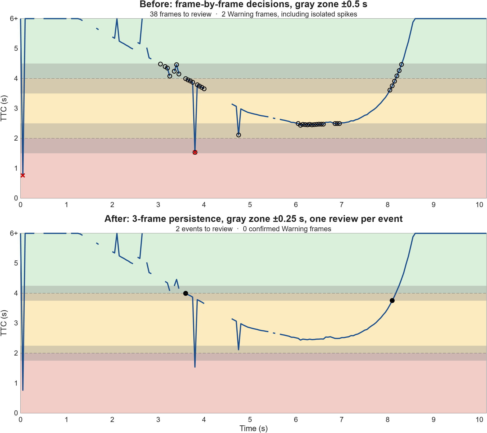

# Gray-Zone Alarm Review

**Automatic thresholds decide the clear cases. People decide the gray zone, and the decision is recorded.**



| | Frame-by-frame decisions | Persistence + event-based review |
|---|---|---|
| Items needing human review | 38 frames of 204 | 2 events |
| Warnings raised by isolated spikes | 2 | 0 |
| Added delay before an alarm is confirmed | none | about 0.1 s (2 extra frames at 20 Hz) |

## Objective

Predictive systems raise more alerts than an expert can confirm. Between "clearly a fault" and "clearly noise" there is a gray zone. This project shows, on real sensor data, how to handle that zone with three engineering rules:

1. **Gray zone.** Values close to a threshold are not classified automatically. They go to human review.
2. **Decision log.** Every review produces a record: proposed class, human decision, rationale, reviewer, time. Rejections are recorded too.
3. **Persistence and event-based review.** An alarm is confirmed only when it lasts N consecutive samples, and a person reviews each gray-zone event once, not every sample.

## State of Research

The idea comes from two sources:

- **Industrial alarm management and process safety.** Persistence filters (on-delay) against nuisance alarms are standard practice in plant alarm systems. In oil & gas, near misses are logged and investigated: a dismissed signal is not a closed case.
- **MATLAB EXPO 2026, workshop "Hands-On Agentic AI for Engineered Systems with MATLAB and Simulink".** In the workshop Q&A, MathWorks engineers answered three questions I asked. Agent output should be treated like any other engineering change, with the disposition and rationale recorded even when a proposal is rejected. Alarm persistence belongs in the requirement, not in the prompt. A gray zone for human review can be specified as a requirement for the agent.

## Expected Contributions

- A minimal, testable implementation of gray zone + decision log + persistence.
- A quantified before/after comparison on real data, including the cost: confirmation delay.
- A pattern that transfers to plant monitoring. Replace time-to-collision with vibration velocity and the thresholds with ISO 20816 zones; the logic stays the same.

## Research Details

**Data.** The city-driving sensor log from the MathWorks workshop exercise: 204 radar frames over about 10 s, one every 0.05 s, with lane boundaries for each frame. The data is **not included** in this repository. Get it from the [workshop repository](https://github.com/mpsavai/Agentic-AI-Workshop-for-Engineered-Systems-with-MATLAB-and-Simulink) (`Exercise2/WorkingFolder_Ex2/data/citySensorLog.mat`).

**Step 1 – Risk signal** (`code/analyzeLeadVehicle.m`). For each frame:

- select the nearest radar object ahead, inside the curved lane, with boundaries modelled as `y = offset + x·tan(heading) + curvature·x²`;
- compute time to collision, `TTC = distance / closing speed`, with TTC set to infinity when the object is stationary or moving away;
- classify: `TTC ≤ 2 s` Warning, `≤ 4 s` Caution, otherwise Normal. These requirements come from the workshop;
- **gray zone**: frames within ±0.5 s of a threshold get status `Review`, and a decision log table is created with empty human fields.

**Step 2 – Persistence and event-based review** (`code/compareGrayZone.m`):

- a class is confirmed only after 3 consecutive frames;
- the gray zone is narrowed to ±0.25 s;
- consecutive review frames are grouped into events, so each event gets one decision.

**Results.** Before: 38 of 204 frames (19%) needed review, and two single-frame spikes became Warnings. Those spikes are most likely objects detected for only one frame. After: 2 review events and no unconfirmed Warnings. The price is about 0.1 s of confirmation delay. On a vehicle that delay must be weighed against braking needs. On a pump degrading over weeks it is irrelevant. In process safety terms, the worst-case delay of any filter must fit within the process safety time.

**Verification.**

- `tests/tGrayZone.m` contains MATLAB unit tests derived from the requirements: classes follow the thresholds, review is assigned exactly near thresholds, non-approaching objects have infinite TTC, human fields in the log start empty, and the headline numbers hold.
- `verify/verify_grayzone.py` is an independent re-implementation in Python that reproduces the headline numbers (38 / 2 / 2 / 0) from the same data file.

**Assumption to check.** Radar `velocity` is treated as relative velocity, negative when the object approaches. The continuity of the resulting TTC curve supports this assumption, but it is not documented in the dataset.

## How to run

```matlab
% 1. Clone the MathWorks workshop repository and open Exercise2/WorkingFolder_Ex2
% 2. Copy code/*.m from this repository into its code/ folder, and tests/ into tests/
S = compareGrayZone;                 % before/after figure + summary
[T, decisionLog] = analyzeLeadVehicle;  % per-frame table + decision log
results = runtests("tests");         % executable checks
```

Developed in MATLAB Online. Requires R2023a or later (`xregion`).

## Next Steps

- Apply the same pattern to vibration monitoring (ISO 20816 zones, persistence over hours, not frames).
- Add a documented reset/clear behaviour and handling of missing frames to the persistence requirement.
- Link the decision log to a management-of-change record, so that a rejected alert remains auditable.

## Acknowledgments

Data and exercise requirements: MathWorks, MATLAB EXPO 2026 agentic AI workshop. Thanks to Marc Segelken, Takuji Fukumoto and Riccardo Consolo for answering my questions in the Q&A.

The code was drafted with an AI assistant. I defined the requirements and the review rules, ran the code, and checked its assumptions and results. That division of roles is the point of this project.

---

Gianluigi Riccardi · Operations Manager, Seveso III upper-tier coastal fuel depot · [gianluigiriccardi.github.io](https://gianluigiriccardi.github.io) · [LinkedIn](https://www.linkedin.com/in/gianluigi-riccardi-ai-industrial)
